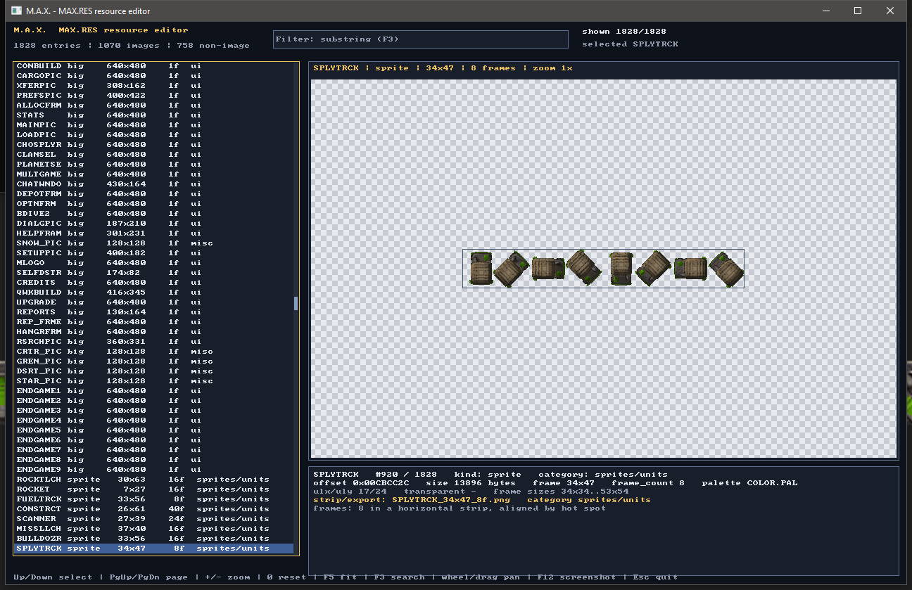

# max-resources-viewer

Просмотр и классификация ресурсов `MAX.RES` (M.A.X.) + пакетный экспорт
изображений в PNG. Отдельный Cargo-проект (свой `Cargo.lock`), path-зависимости
на `max_assets` и `max_render`; в workspace `max-brh` не входит.



*Скриншот настоящего окна SDL3 на Windows: выбран `SPLYTRCK`, 8 кадров.*

## Возможности

* **Классификатор**: для всех 1828 записей `MAX.RES` — `kind`
  (`simple`/`big`/`sprite`/`shadow`/`cursor`/`non-image`), категория
  (`ui`/`sprites/units`/`misc`), offset/size, размеры, число кадров, палитра,
  hot spot, первые байты.
* **Пакетный экспорт** `--export`: PNG-файлы по категориям + `manifest.csv` +
  отчёт. Работает без SDL.
* **UI**: список с фильтром и прокруткой, превью кадра/ленты кадров с зумом и
  панорамой, метаданные; для не-изображений — тип, ссылка и hex первых байт.
* **Старт без аргументов**: поиск `MAX.RES` рядом с exe / в CWD / вверх по
  дереву, затем нативный диалог с фильтром `*.RES`; `COLOR.PAL` — рядом с
  архивом или заглушка-палитра с предупреждением.
* **Экспорт 1069 PNG** из реального `MAX.RES` ≈ 10,1 МБ (см.
  [`max-assets/README.md`](../../max-assets/README.md)).
* **Без консольного окна**: `.exe` всегда собирается с подсистемой Windows
  (GUI), двойной клик открывает только окно редактора. Headless-режимы
  дублируют вывод в файлы — см. «Логи headless-режимов».
* **Тесты** на реальном архиве: 1828/1828, известные теги, размеры PNG,
  идемпотентность.

## Сборка

### Headless (без SDL) — всегда

```sh
cd max-brh-qa-tools/max-resources-viewer
cargo build --release
cargo run --release -- --export \
  ../../max-original/MAX.RES ../../max-original/COLOR.PAL ../../max-assets
```

### Windows + SDL3 через vcpkg (как `max_app`)

```powershell
vcpkg install sdl3:x64-windows
$env:VCPKG_ROOT = "C:\path\to\vcpkg"
cargo build --release --features sdl-vcpkg
# или одной командой (MSVC + vcpkg, DLL рядом с exe, пакет в dist\):
powershell -ExecutionPolicy Bypass -File build.ps1
```

`SDL3.dll` должна быть рядом с `.exe` или в `PATH`. `build.ps1` после сборки
проверяет PE-заголовок: Subsystem=2 (GUI), иначе двойной клик открыл бы
консоль (`build/scripts/pe-subsystem.ps1`).

### Windows + готовый SDL3 (вариант без vcpkg)

Скачать `SDL3-devel-<ver>-VC.zip` с github.com/libsdl-org/SDL, распаковать и
указать линковщику каталог `lib\x64`:

```powershell
$sdl = "D:\dev\max-port-debug\build\sdl3-3.4.20\SDL3-3.4.20"
$env:PATH = "$sdl\lib\x64;$env:PATH"
$env:RUSTFLAGS = "-L native=$sdl\lib\x64"
cargo build --release --features sdl
```

Именно так собран скриншот выше (SDL3 3.4.20; `build/` в git не входит).

### Linux

```sh
sudo apt install libsdl3-dev
cargo build --release --features sdl
```

`--features sdl-from-source` собирает SDL3 из исходников (нужен cmake).

## Запуск

При старте UI `MAX.RES` ищется в таком порядке:

1. аргумент командной строки — `--res PATH` или позиционный `max-resources-viewer PATH`;
2. дефолтные пути:
   * рядом с `.exe` — `<exe_dir>/MAX.RES`, `<exe_dir>/max-original/MAX.RES`;
   * вверх по дереву от каталога `.exe` — `<ancestor>/max-original/MAX.RES`
     (так запуск из `target/release` находит корень репозитория);
   * в текущем каталоге — `./MAX.RES`, `./max-original/MAX.RES`;
   * вверх по дереву от текущего каталога — `<ancestor>/max-original/MAX.RES`;
3. если ничего не найдено — нативный диалог **«Укажите файл MAX.RES»**
   с фильтром `*.RES` (SDL3). Окно редактора открывается только после выбора:
   приложение ждёт решения пользователя.

Отмена диалога — не аварийная ситуация, но работать не с чем: сообщение
пишется в `max-resources-viewer-error.txt` в текущем каталоге (консоли у
GUI-подсистемы нет), процесс завершается с кодом **1**:

```
error: выбор MAX.RES отменён — редактор не открыт.
       Укажите файл аргументом: max-resources-viewer --res <MAX.RES>
```

`COLOR.PAL` ищется рядом с выбранным `MAX.RES`. Если файла нет (или явный
`--pal PATH` не читается, а соседнего тоже нет), редактор **продолжает
работать**: в stderr и в статусной строке окна появляется предупреждение, а
превью рисуется заглушкой-палитрой (256 градаций серого). Это позволяет
открыть один `MAX.RES` из любого каталога, не копируя палитру.

```sh
# UI из корня репозитория: MAX.RES найдётся в ./max-original/MAX.RES
./max-brh-qa-tools/max-resources-viewer/target/release/max-resources-viewer

# явные пути + начальный выбор
cargo run --release --features sdl -- --res ../../max-original/MAX.RES \
                    --pal ../../max-original/COLOR.PAL \
                    --select TANK

# то же позиционным аргументом
cargo run --release --features sdl -- ../../max-original/MAX.RES --select TANK

# сохранить кадр интерфейса и выйти (headless-проверка отрисовки)
cargo run --features sdl -- --res ../../max-original/MAX.RES \
  --pal ../../max-original/COLOR.PAL --shot out.png --select FRAMEPIC
```

Headless-команды (`--export`, `--report`) работают как раньше: диалог не
показывается, пути передаются аргументами, `COLOR.PAL` для `--export`
обязателен. Итог этих команд дополнительно пишется в файл — см. ниже.

Без `--features sdl` бинарник всё равно собирается и умеет `--export`/
`--report`; попытка открыть UI завершается понятной ошибкой.

### Логи headless-режимов (GUI-подсистема)

Бинарь всегда собирается с подсистемой Windows (GUI), поэтому двойной клик не
открывает консоль; у `.exe` нет stdout/stderr в терминале. Чтобы результат
`--export`/`--report` не терялся, он дублируется в файл:

| Режим | Файл с итогом |
|---|---|
| `--export <RES> <PAL> <OUT_ROOT>` | `<OUT_ROOT>/export-log.txt` — рядом с `images/` и `manifest.csv`; полный отчёт по записям — `<OUT_ROOT>/images/EXPORT-REPORT.txt` |
| `--report <RES> [PAL]` | `./report.txt` — в текущем каталоге |
| любая ошибка (включая UI и отмену диалога) | `./max-resources-viewer-error.txt` — в текущем каталоге |

Ошибки `--export`/`--report` попадают и в их лог (`export-log.txt`/`report.txt`),
и в `max-resources-viewer-error.txt`. Если `OUT_ROOT` не передан (не хватает
аргументов), `export-log.txt` пишется в текущий каталог. Вывод в stdout
сохранён: под `cargo run` или с перенаправлением он виден как раньше.

```powershell
# справка и итог отчёта доступны через файл/перенаправление:
max-resources-viewer.exe --help > help.txt
max-resources-viewer.exe --report ../../max-original/MAX.RES
Get-Content .\report.txt
```

### Ручная проверка диалога

Автоматически проверяются порядок поиска, ветка отмены (мок диалога) и
сборка диалогового пути; сам нативный диалог удобно проверить руками:

1. скопировать `max-resources-viewer.exe` и `SDL3.dll` в пустой каталог
   (без `MAX.RES`/`max-original`, и вне репозитория);
2. запустить `.exe` без аргументов из этого каталога;
3. убедиться, что открылся диалог с заголовком «Укажите файл MAX.RES» и
   фильтром `*.RES`, а окно редактора не появилось;
4. выбрать `MAX.RES` — редактор должен открыться; при отсутствии
   `COLOR.PAL` рядом появится предупреждение и серое превью;
5. повторить запуск и нажать «Отмена» — сообщение об отмене в
   `max-resources-viewer-error.txt` (текущий каталог), код возврата 1.

Проверка на Windows без ручного клика: диалог можно закрыть крестиком через
`WM_CLOSE`; процесс завершается с кодом 1 и тем же сообщением в
`max-resources-viewer-error.txt` (так проверялся этот сценарий).

## Горячие клавиши

| Клавиша | Действие |
|---|---|
| `Up` / `Down` | выбор строки |
| `PgUp` / `PgDn` | на страницу |
| `Home` / `End` | первая/последняя |
| `+` / `-` | зум превью (1×…8×) |
| `0` | сбросить зум/панораму |
| `F5` | вписать превью |
| `F3` | фокус в поле поиска |
| печатный символ | добавить в фильтр (поиск включается сам) |
| `Backspace` | удалить символ фильтра |
| `Delete` | очистить фильтр |
| `Enter` | применить фильтр (снять фокус) |
| колесо мыши | прокрутка превью (или списка под курсором) |
| drag ЛКМ по превью | панорама |
| `F12` | сохранить кадр в `max-resources-viewer-screenshot.png` |
| `Esc` | выход |

Фильтр — подстрока имени без учёта регистра («tank» → `TANK`, `S_TANK`,
`TANK1`, …). Клик по строке выбирает, клик по полю — фокус поиска.

## CLI

```
max-resources-viewer [--res PATH] [--pal PATH] [--select TAG] [--shot OUT.png]
max-resources-viewer [MAX.RES]
max-resources-viewer --export <MAX.RES> <COLOR.PAL> <OUT_ROOT>   # итог: <OUT_ROOT>/export-log.txt
max-resources-viewer --report <MAX.RES> [COLOR.PAL]            # итог: ./report.txt
max-resources-viewer --help
```

`--res` и позиционный `MAX.RES` эквивалентны; при отсутствии пути работает
поиск/диалог из раздела «Запуск».

`--export` печатает сводку (она же сохраняется в `<OUT_ROOT>/export-log.txt`):

```
entries: 1828  images: 1070 (ui 537, sprites/units 170, misc 363)
kinds: simple 649, big 152, sprite 162, shadow 78, cursor 29
non-images: 758
  wav-ref  607
  wrl-ref  24
  flc-ref  71
  msc-ref  16
  mve-ref  3
  script   3
  text     2
  data     32
written: 1069 PNG (10139355 bytes), duplicate paths skipped: 1; errors: 0
```

## Как классифицируется

Порядок (подробно — `src/model.rs`):

1. **курсор** — только теги `CURSOR_RESOURCES` и точный размер
   `8 + w*h*frames`. Иначе `HANDPTR` структурно неотличим от simple image;
2. **тень** — только `S_*`, `decode_shadow`;
3. **simple** — `SimpleImage` и точный размер `8 + w*h`;
4. **sprite** — `decode_sprite` (проверяет все кадры/строки);
5. **big** — `BigImage` + проверка заголовка (`0 < w,h ≤ 1024`): декодер
   намеренно терпим к короткому RLE, и без проверки он «успешно» читает даже
   `ATTRIBS`/`TIPS`;
6. fallback `shadow`/`cursor` для нестандартных тегов;
7. иначе **non-image**: ASCIIZ-ссылка (`.spw`/`.wrl`/`.flc`/`.msc`/`.mve`),
   TTF (`FONT_*`/`FFTM`), текст/скрипт (`;`/`[`), двоичные `D_*`.

Категория: `S_*` и 92 имени `UNIT_SPRITES` → `sprites/units`; курсоры, `I_*`,
`P_*`, `A_*`, `E_*`, маркеры, планеты, логотипы, `CH_CN*`/`CH_TM*` → `misc`;
остальные изображения → `ui`.

## Экспорт

Кадры спрайтов/теней/курсоров укладываются горизонтальной лентой по горячей
точке. Прозрачность — настоящая альфа (RGBA PNG); полностью непрозрачные
кадры пишутся RGB (палитровый PNG). Тень — чёрный с альфой 160. Имена:
`TAG_WxH_Nf[_ownpal|_mask].png`.

Полный список полей — `images/manifest.csv`
(`index,name,offset_hex,size,kind,category,width,height,frames,palette,
transparent,non_image,ref,file`).

## Тесты

```sh
cargo test                 # 35 unit + 4 integration on real MAX.RES/PATCHES.RES
cargo test --features sdl  # то же + сборка SDL-слоя и диалога
```

Проверки:

* `all_1828_max_res_entries_are_classified` — 1828 записей, 1070 изображений,
  758 не-изображений; у каждой записи есть kind/категория/подтип;
* `known_tags_have_expected_kind_and_category` — `FRAMEPIC`, `TANK`, `S_TANK`,
  `HANDPTR`, `SNOW_PIC`, `PANELTOP`, `P_TANK`, `I_TANK`, `TANK1`, `SNOW_1`;
* `font_ttf_in_patches_is_non_image_ttf` — `FONT_1` из `assets/PATCHES.RES`;
* `export_of_selected_images_has_expected_dimensions_and_is_idempotent` —
  `TANK`/`FRAMEPIC`/`SNOW_PIC`: размеры ленты/картинок и побайтовый повтор;
* `startup::tests::*` — порядок поиска `MAX.RES` (аргумент → exe → CWD →
  вверх по дереву), отмена/ошибка диалога через мок, поиск `COLOR.PAL` рядом
  с архивом и заглушка-палитра.

## Устройство

| Модуль | Назначение |
|---|---|
| `model.rs` | классификатор, категории, статистика, non-image |
| `render.rs` | RGBA-растеризация: палитра, прозрачность, лента кадров |
| `export.rs` | запись PNG + `manifest.csv` + отчёт |
| `png.rs` | PNG-кодек (копия `max_app::qa::png`, добавлен RGBA) |
| `ui.rs` | чистое состояние/отрисовка кадра (без SDL), тестируется headless |
| `startup.rs` | поиск `MAX.RES`/`COLOR.PAL`, порядок старта, заглушка-палитра |
| `app.rs` | SDL3-окно, ввод, презентация (feature `sdl`) |
| `dialog.rs` | нативный диалог выбора `MAX.RES` через SDL3 FFI (feature `sdl`) |
| `main.rs` | CLI и выбор headless/UI; файловые логи `--export`/`--report` |

`ui.rs` рисует тот же кадр, что уходит в SDL; `--shot`/F12 сохраняют его без
окна. Реальный скриншот окна снят с запущенного `.exe` (Windows, SDL3).

Диалог использует `SDL_ShowFileDialogWithProperties` из `sdl3-sys` напрямую:
безопасная обёртка `sdl3::dialog::show_open_file_dialog` (crate 0.22.1) не
умеет задавать заголовок, а `SDL3.dll` 3.4.20 экспортирует properties-вариант
(проверено `dumpbin /exports`). `unsafe` изолирован в `dialog.rs` бинарника;
библиотека по-прежнему собирается с `#![forbid(unsafe_code)]`.
