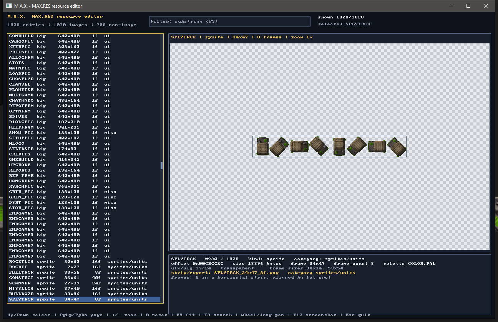

# max-resource-editor

Просмотр и классификация ресурсов `MAX.RES` (M.A.X.) + пакетный экспорт
изображений в PNG. Отдельный Cargo-проект (свой `Cargo.lock`), path-зависимости
на `max_assets` и `max_render`; в workspace `max-rust` не входит.



*Скриншот настоящего окна SDL3 на Windows: выбран `SPLYTRCK`, 8 кадров.*

## Возможности

* **Классификатор**: для всех 1828 записей `MAX.RES` — `kind`
  (`simple`/`big`/`sprite`/`shadow`/`cursor`/`non-image`), категория
  (`ui`/`sprites/units`/`misc`), offset/size, размеры, число кадров, палитра,
  hot spot, первые байты.
* **Пакетный экспорт** `--export`: PNG-файлы по категориям + `manifest.csv` +
  отчёт. Работает без SDL.
* **UI**: список с фильтром и прокруткой, превью кадра/ленты кадров с зумом и
  панорамой, метаданные; для не-изображений — тип, ссылка и hex первых байт.
* **Экспорт 1069 PNG** из реального `MAX.RES` ≈ 10,1 МБ (см.
  [`max-assets/README.md`](../../max-assets/README.md)).
* **Тесты** на реальном архиве: 1828/1828, известные теги, размеры PNG,
  идемпотентность.

## Сборка

### Headless (без SDL) — всегда

```sh
cd tools/max-resource-editor
cargo build --release
cargo run --release -- --export \
  ../../max-original/MAX.RES ../../max-original/COLOR.PAL ../../max-assets
```

### Windows + SDL3 через vcpkg (как `max_app`)

```powershell
vcpkg install sdl3:x64-windows
$env:VCPKG_ROOT = "C:\path\to\vcpkg"
cargo build --release --features sdl-vcpkg
```

`SDL3.dll` должна быть рядом с `.exe` или в `PATH`.

### Windows + готовый SDL3 (вариант без vcpkg)

Скачать `SDL3-devel-<ver>-VC.zip` с github.com/libsdl-org/SDL, распаковать и
указать линковщику каталог `lib\x64`:

```powershell
$sdl = "D:\dev\max-port-debug\build\sdl3-3.4.20\SDL3-3.4.20"
$env:PATH = "$sdl\lib\x64;$env:PATH"
$env:RUSTFLAGS = "-L native=$sdl\lib\x64"
cargo build --release --features sdl
```

Именно так собран скриншот выше (SDL3 3.4.20; `build/` в git не входит).

### Linux

```sh
sudo apt install libsdl3-dev
cargo build --release --features sdl
```

`--features sdl-from-source` собирает SDL3 из исходников (нужен cmake).

## Запуск

```sh
# UI из корня репозитория; без флагов пути по умолчанию:
# max-original/MAX.RES и max-original/COLOR.PAL
./tools/max-resource-editor/target/release/max-resource-editor

# явные пути + начальный выбор
cargo run --release --features sdl -- --res ../../max-original/MAX.RES \
                    --pal ../../max-original/COLOR.PAL \
                    --select TANK

# сохранить кадр интерфейса и выйти (headless-проверка отрисовки)
cargo run --features sdl -- --res ../../max-original/MAX.RES \
  --pal ../../max-original/COLOR.PAL --shot out.png --select FRAMEPIC
```

Без `--features sdl` бинарник всё равно собирается и умеет `--export`/
`--report`; попытка открыть UI завершается понятной ошибкой.

## Горячие клавиши

| Клавиша | Действие |
|---|---|
| `Up` / `Down` | выбор строки |
| `PgUp` / `PgDn` | на страницу |
| `Home` / `End` | первая/последняя |
| `+` / `-` | зум превью (1×…8×) |
| `0` | сбросить зум/панораму |
| `F5` | вписать превью |
| `F3` | фокус в поле поиска |
| печатный символ | добавить в фильтр (поиск включается сам) |
| `Backspace` | удалить символ фильтра |
| `Delete` | очистить фильтр |
| `Enter` | применить фильтр (снять фокус) |
| колесо мыши | прокрутка превью (или списка под курсором) |
| drag ЛКМ по превью | панорама |
| `F12` | сохранить кадр в `max-resource-editor-screenshot.png` |
| `Esc` | выход |

Фильтр — подстрока имени без учёта регистра («tank» → `TANK`, `S_TANK`,
`TANK1`, …). Клик по строке выбирает, клик по полю — фокус поиска.

## CLI

```
max-resource-editor [--res PATH] [--pal PATH] [--select TAG] [--shot OUT.png]
max-resource-editor --export <MAX.RES> <COLOR.PAL> <OUT_ROOT>
max-resource-editor --report <MAX.RES> [COLOR.PAL]
max-resource-editor --help
```

`--export` печатает сводку:

```
entries: 1828  images: 1070 (ui 537, sprites/units 170, misc 363)
kinds: simple 649, big 152, sprite 162, shadow 78, cursor 29
non-images: 758
  wav-ref  607
  wrl-ref  24
  flc-ref  71
  msc-ref  16
  mve-ref  3
  script   3
  text     2
  data     32
written: 1069 PNG (10139355 bytes), duplicate paths skipped: 1; errors: 0
```

## Как классифицируется

Порядок (подробно — `src/model.rs`):

1. **курсор** — только теги `CURSOR_RESOURCES` и точный размер
   `8 + w*h*frames`. Иначе `HANDPTR` структурно неотличим от simple image;
2. **тень** — только `S_*`, `decode_shadow`;
3. **simple** — `SimpleImage` и точный размер `8 + w*h`;
4. **sprite** — `decode_sprite` (проверяет все кадры/строки);
5. **big** — `BigImage` + проверка заголовка (`0 < w,h ≤ 1024`): декодер
   намеренно терпим к короткому RLE, и без проверки он «успешно» читает даже
   `ATTRIBS`/`TIPS`;
6. fallback `shadow`/`cursor` для нестандартных тегов;
7. иначе **non-image**: ASCIIZ-ссылка (`.spw`/`.wrl`/`.flc`/`.msc`/`.mve`),
   TTF (`FONT_*`/`FFTM`), текст/скрипт (`;`/`[`), двоичные `D_*`.

Категория: `S_*` и 92 имени `UNIT_SPRITES` → `sprites/units`; курсоры, `I_*`,
`P_*`, `A_*`, `E_*`, маркеры, планеты, логотипы, `CH_CN*`/`CH_TM*` → `misc`;
остальные изображения → `ui`.

## Экспорт

Кадры спрайтов/теней/курсоров укладываются горизонтальной лентой по горячей
точке. Прозрачность — настоящая альфа (RGBA PNG); полностью непрозрачные
кадры пишутся RGB (палитровый PNG). Тень — чёрный с альфой 160. Имена:
`TAG_WxH_Nf[_ownpal|_mask].png`.

Полный список полей — `images/manifest.csv`
(`index,name,offset_hex,size,kind,category,width,height,frames,palette,
transparent,non_image,ref,file`).

## Тесты

```sh
cargo test                 # 19 unit + 4 integration on real MAX.RES/PATCHES.RES
cargo test --features sdl  # то же + сборка SDL-слоя
```

Проверки:

* `all_1828_max_res_entries_are_classified` — 1828 записей, 1070 изображений,
  758 не-изображений; у каждой записи есть kind/категория/подтип;
* `known_tags_have_expected_kind_and_category` — `FRAMEPIC`, `TANK`, `S_TANK`,
  `HANDPTR`, `SNOW_PIC`, `PANELTOP`, `P_TANK`, `I_TANK`, `TANK1`, `SNOW_1`;
* `font_ttf_in_patches_is_non_image_ttf` — `FONT_1` из `assets/PATCHES.RES`;
* `export_of_selected_images_has_expected_dimensions_and_is_idempotent` —
  `TANK`/`FRAMEPIC`/`SNOW_PIC`: размеры ленты/картинок и побайтовый повтор.

## Устройство

| Модуль | Назначение |
|---|---|
| `model.rs` | классификатор, категории, статистика, non-image |
| `render.rs` | RGBA-растеризация: палитра, прозрачность, лента кадров |
| `export.rs` | запись PNG + `manifest.csv` + отчёт |
| `png.rs` | PNG-кодек (копия `max_app::qa::png`, добавлен RGBA) |
| `ui.rs` | чистое состояние/отрисовка кадра (без SDL), тестируется headless |
| `app.rs` | SDL3-окно, ввод, презентация (feature `sdl`) |
| `main.rs` | CLI и выбор headless/UI |

`ui.rs` рисует тот же кадр, что уходит в SDL; `--shot`/F12 сохраняют его без
окна. Реальный скриншот окна снят с запущенного `.exe` (Windows, SDL3).
